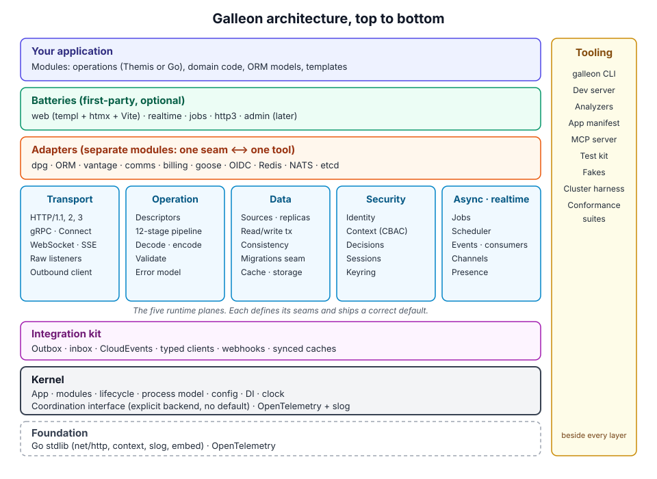

# Galleon, Part 5: The Architecture

Builds on parts [1](01-crash-course.md), [2](02-strengths-and-shortcomings.md), [3](03-complete-component-list.md) and [4](04-desires-debate.md). Component IDs (A1, J4, O2…) refer to part 3, decisions (D1–D12) and pushbacks (P1–P10) to part 4.

This is a first full draft for us to argue over, not a frozen spec. Code is **sketch-level**: the names and shapes show intent and will change. The repository is `github.com/thec1oud/galleon`. The other modules live in subdirectories of the same repository, each with its own `go.mod`.

---

## 0. Principles

Every rule below traces back to a decision we made. When a design question comes up later, these settle it:

1. **Correct > ergonomic > efficient > complete in core** (D5). Hot paths have a budget: no per-request reflection or allocation added for convenience unless the user opts in.
2. **`net/http` is the foundation, never replaced.** Everything mounts as an `http.Handler`.
3. **Seams sit at the touchpoint, not over the whole tool** (P2). A seam captures only what Galleon itself needs to touch.
4. **A seam is complete only with all four of these** (P1): interface, default adapter, conformance suite, test fake.
5. **Where a standard exists, the standard is the seam:** OpenTelemetry, `slog`, OIDC, AuthZEN, CloudEvents, OpenFeature, OpenAPI, protobuf, problem+json.
6. **Galleon owns what must never fork** (P8): the handler and pipeline model, the operation model, the error model, context and transaction propagation, the coordination interface, and the lifecycle.
7. **Dependency direction** (P6): your systems never import Galleon, and Galleon's core never imports your systems. Adapters are separate modules.
8. **Every component is replication-aware.** If it holds state, it states whether that state is per-process or cluster-wide, and it gets cluster-wide state only through coordination (O2).
9. **Explicit over magic.** No global state, no init-time registration, no wiring you can't find with "go to definition". Reflection is allowed at boot, never per request.
10. **Fail at boot, not at 3 a.m.** Wiring, routes, policies, coordination needs, schema status and config are all validated before a node reports ready.

---

## 1. The big picture



The same layers as a table, from top to bottom:

| Layer | What's in it |
|---|---|
| **Your application** | Modules: operations (Themis or Go), domain code, ORM models, templates |
| **Batteries** (first-party, optional) | web (templ + htmx + Vite), realtime, jobs, http3, admin (later) |
| **Adapters** (one seam ⟷ one tool) | dpg, ORM, vantage, comms, billing, goose, OIDC, Redis, NATS, etcd |
| **Transport plane** | HTTP/1.1, 2 and 3, gRPC and Connect, WebSocket, SSE, raw listeners, outbound client |
| **Operation plane** | Descriptors, the 12-stage pipeline, decode and encode, validation, the error model |
| **Data plane** | Sources and replicas, typed read/write transactions, consistency, the migration seam, cache, storage |
| **Security plane** | Identity, operating context (CBAC slot), decisions, sessions, keyring |
| **Async and realtime plane** | Jobs, scheduler, events and consumers, channels, presence |
| **Integration kit** | Outbox, inbox, CloudEvents, typed clients, webhooks, synced caches |
| **Kernel** | App, modules, lifecycle, process model, config, DI, clock, coordination interface, OpenTelemetry and slog |
| **Foundation** | Go stdlib (net/http, context, slog, embed), OpenTelemetry |
| **Tooling** (beside every layer) | CLI, dev server, analyzers, app manifest, MCP server, test kit, fakes, cluster harness, conformance suites |


- **The kernel** knows nothing about HTTP, databases or identity. It runs modules, owns the lifecycle, and provides coordination and observability.
- **The planes** are the runtime subsystems. Each plane defines its seams and ships the minimum default needed to be correct.
- **The integration kit** is the one way to talk to an external system (P3). comms, vantage, billing and any third party all go through it.
- **Adapters** connect a seam to a specific tool.
- **Batteries** are larger, optional first-party features built only on public seams. A battery never gets private access to the core.

---

## 2. Module layout and dependency rules

| Go module | Contains | May depend on |
|---|---|---|
| `github.com/thec1oud/galleon` | Kernel, all plane **interfaces**, the operation model, the error model, HTTP and Connect transport, `local` coordination, in-memory defaults that are safe for single-node, and the pgx data plane in package `pg` | stdlib, OpenTelemetry API, `connectrpc.com/connect`, pgx |
| `github.com/thec1oud/galleon/testkit` | Fakes for every seam, the cluster harness, conformance suite runners | core |
| `github.com/thec1oud/galleon/pg` (a package of the core module) | pgx-native data plane: sources, transactions, consistency tokens, replica tracking, Postgres outbox and inbox | core, pgx |
| `github.com/thec1oud/galleon/coord-{pg,redis,nats,etcd}` | Coordination backends | core, each driver |
| `github.com/thec1oud/galleon/jobs` | The job system and scheduler (backend-pluggable, Postgres first) | core |
| `github.com/thec1oud/galleon/web` | templ integration, fragments, forms, flash, Vite manifest and dev proxy | core, templ |
| `github.com/thec1oud/galleon/realtime` | Channels, presence, WebSocket and SSE fan-out | core |
| `github.com/thec1oud/galleon/http3` | HTTP/3 listener | core, quic-go |
| `github.com/thec1oud/galleon/adapters/{dpg,orm,vantage,comms,billing,goose,oidc,openfeature,…}` | One adapter per tool | core and that tool only |
| `github.com/thec1oud/galleon/cmd/galleon` | The CLI | anything |
| Themis repo: `themis-galleon` | Themis's Galleon generator target | core's operation model only |

The rules are enforced in CI with an import-graph check:
- Core imports no battery and no adapter.
- A battery imports only core's public API.
- An adapter imports core, plus its one tool.
- Nothing imports `testkit` except tests.

---

## 3. The kernel

### 3.1 The app and modules (A1, A7)

```go
app := galleon.New(
    galleon.Name("orders"),
    galleon.Coordination(coordpg.Backend(pool)), // required, no default (D7)
    galleon.Modules(
        pg.Module(pgcfg),         // data plane
        orders.Module(),          // your code
        web.Module(webcfg),       // a battery
        vantage.Module(vcfg),     // an adapter
    ),
)
os.Exit(app.Run(os.Args)) // serve, worker, migrate, routes, … from one binary
```

A **module** is the unit of encapsulation (the Symfony and Phoenix lessons):

```go
type Module interface {
    Name() string
    Register(r *Registry) error // the ONLY place a module contributes anything
}
```

Through the `Registry` a module contributes providers (dependencies), operations, middleware, jobs, schedules, event handlers, migrators, health checks, config sections, templates and assets. It declares coordination needs and the other modules it requires. Nothing registers itself globally, so the whole app is visible from `galleon.New`.

### 3.2 Dependency wiring (A6)

**Typed providers, resolved and validated once at boot.**

```go
galleon.Provide(r, NewOrderService)          // func(repo *OrderRepo, clk clock.Clock) *OrderService
galleon.Provide(r, NewOrderRepo, galleon.Scope(galleon.Singleton))
```

- Constructors are plain Go functions. Galleon uses reflection **once at boot** to read their parameter types and build the graph. It is never used per request.
- One constructor provides each type. Values several modules contribute go into a collection instead: `galleon.Collect(r, values...)` adds to the app's collection of `T`, which the kernel provides as `[]T`, in module installation order and then call order, once every module has registered. A consumer, whether it takes `[]T` in a constructor or reads it with `Resolve`, calls `Collect` with no values, which declares the collection, so that `[]T` is provided even when nothing is added; providing or replacing `[]T` fails boot, and `Collect` after `New` has provided the collections panics rather than drop its values. Each consumer gets the slice full to its capacity, so an append copies. A value with a `Validate() error` method, on `T` or `*T`, is checked as it is collected (a nil pointer or func isn't), and fails boot naming the module and line, as a config section does. Values collected with nothing declaring or taking their collection fail boot too, naming where the first was added, since they would go nowhere; this is usually a consumer's module that isn't installed, or a mismatched type: models collected by pointer (`*data.ModelInfo`) are refused this way, and the error suggests the type that is declared or taken, the value for a pointer or the pointer for a value, or an interface the type implements. A collection that is also provided or replaced reports only that conflict. Models (§7.6) are the first collection.
- The whole graph is validated before anything starts: missing providers, cycles, scope violations, unused providers (a warning). Errors name the module and constructor, and say how to fix them (U7).
- Scopes: `Singleton` (per process), `PerOperation` and `PerJob`. **Cluster-wide singletons are not a DI scope.** They come from coordination (`coord.Leader`), so they can never be confused with per-process singletons (O6).
- An optional codegen mode (`galleon generate wire`) can emit the same graph as plain Go for anyone who wants zero reflection even at boot. Both modes go through the same validation.

### 3.3 Lifecycle (A2, A3, A5)

| Phase | What happens |
|---|---|
| 1. **Configure** | Config is loaded from every source and validated |
| 2. **Build** | Modules register; the dependency graph is built |
| 3. **Validate** | Graph, operations, security declarations and coordination needs are checked |
| 4. **Start** | Components start in dependency order |
| 5. **Ready** | Every readiness gate passes (schema status, cluster join, required backends, warm caches); traffic is accepted |
| 6. **Serving** | Normal operation |
| 7. **Drain** | Traffic is handed off (steps below) |
| 8. **Stop** | Components stop in reverse order |


- **Hooks:** `OnStart` and `OnStop` per provider, run in dependency order on start and reverse order on stop, each with a timeout.
- **Readiness gates** (A2) are registered by modules. The migration seam registers "schema UpToDate", the coordination layer "joined cluster", and so on. Ready means *all* gates pass.
- **Drain** runs in this order:
  1. Readiness goes off, and Galleon waits a configurable grace period so load balancers stop sending traffic.
  2. Listeners stop accepting.
  3. Long-lived connections (WebSocket, SSE, gRPC streams) get a go-away or reconnect signal.
  4. In-flight requests finish.
  5. Job leases are released for other nodes to pick up.
  6. Telemetry is flushed.

  Each step has its own deadline.

### 3.4 Process model (A4, O12)

**One binary, several roles, any topology.**

- **Roles:** `web`, `rpc`, `worker`, `scheduler`, `realtime`, or `all`, chosen by flag or config. Every role runs the same kernel and modules. Only the active planes differ.
- **Multi-process on one host:** `galleon serve --processes=N` starts a supervisor that forks N workers sharing ports via `SO_REUSEPORT` (Fiber's prefork, done on `net/http`). The supervisor restarts crashed workers and performs zero-downtime binary upgrades by starting a new generation before draining the old one.
- **Multi-node:** identical to multi-process, except the workers are on different machines. **The code never changes.** Only the coordination backend's configuration does.
- **Node identity:** each process has a `NodeID` (host, process ID, generation) used in coordination, telemetry and leases.

### 3.5 Configuration (B1–B6)

- **One typed config struct per module**, declared via `galleon.Config[T](r, "orders")`, with defaults and validation tags or a `Validate() error` method.
- **Sources, in order of precedence:** defaults < files (YAML, TOML or JSON) < environment variables < flags < a remote source (seam). Every value remembers where it came from.
- **Introspection:** `galleon config` and the ops endpoint show effective values and their sources, with secrets redacted (B2).
- **Dynamic values:** fields marked `Dynamic[T]` can change at runtime. They propagate cluster-wide through coordination, and subscribers are notified (B3).
- **Secrets:** a `secrets` seam (env, file, Vault, cloud secret managers). Rotation notifies subscribers, and secrets are never logged (B4).
- **Environment profiles** (`dev`, `test`, `prod`) change only safe defaults, such as detailed error pages. They never change semantics. **As built:** `galleon.Environment(galleon.Production | Development | Test)`, Production by default; so far it sets only the migration policy's defaults (§7.7).

---

## 4. Coordination (O1–O12), the root of every multi-node behaviour

### 4.1 The interface

Galleon owns the interface (P8). Backends implement it.

```go
package coord

type Backend interface {
    Capabilities() Capabilities // what this backend guarantees (see 4.2)

    Membership() Membership     // nodes, roles, join/leave events, failure detection
    Locks() Locker              // leases with TTL and fencing tokens
    Leader(name string) Election
    PubSub() PubSub             // cluster-wide topics, at-most-once
    KV() KV                     // small shared state, compare-and-swap, TTL
    Counters() Counters         // atomic counters and windows (rate limits, metering)
}
```

Fencing tokens are mandatory on locks. Anything a lock protects (migrations, cron, singleton jobs) receives the token, and can reject a stale holder. That's the difference between "probably safe" and correct.

### 4.2 Explicit configuration and capability checks (D7)

- There is **no default backend**. `galleon.New` without `Coordination(...)` fails at boot with a message listing the options. `coord.Local()` must be chosen explicitly for a single-node deployment.
- Components **declare needs** at registration: `r.Needs(coord.ClusterLocks, coord.ClusterPubSub)`.
- At boot, Galleon compares the declared needs with the backend's `Capabilities()`:
  - `Local` with a declared deployment of `single-node` passes.
  - `Local` with any hint of more than one instance (when detectable, e.g. Kubernetes replica count) fails boot, unless the user explicitly sets `allowPerProcessGuarantees`. Then every affected component logs at boot that its guarantees are per-process.

### 4.3 Backends

| Backend | Good for | Notes |
|---|---|---|
| `local` | Single node, dev, tests | In-process. Exact guarantees for one process only. |
| `pg` | Apps that already run Postgres | Advisory locks for leases, `LISTEN/NOTIFY` for pub/sub, tables for KV and counters. No extra infrastructure. |
| `redis` | High-rate counters and pub/sub | Leases with fencing via Lua scripts. |
| `nats` | Messaging-heavy systems | JetStream KV, subjects for pub/sub. |
| `etcd` | Strong consistency needs | Native leases, election and watch. |

Each backend passes the coordination conformance suite. The suite includes partition and failover tests run by the cluster harness (T7).

---

## 5. Transport plane (C1–C14)

| Protocol | Implementation | Notes |
|---|---|---|
| HTTP/1.1, HTTP/2, h2c | `net/http` | Galleon owns the `http.Server` configuration: timeouts, limits and slowloris protection on by default. |
| HTTP/3 | `github.com/thec1oud/galleon/http3` battery | quic-go. Advertised via `Alt-Svc`. |
| gRPC, gRPC-Web, Connect | **connect-go**, mounted on the same `http.Handler` tree | One handler serves services, browsers and **mobile clients** (your mobile requirement). The standard gRPC health and reflection services are built in. |
| WebSocket, SSE | Core primitives, with the realtime battery on top | Auth runs on connect through the same security pipeline. |
| Raw TCP, UDP or Unix | `galleon.Listener` | Same lifecycle, drain and telemetry for custom protocols (C10). |
| Outbound HTTP and RPC | `galleon/client` | The **same interceptor model as the server**, with resilience policies, trace propagation and credential injection (C14, O8). |

Listeners support multiple ports, Unix sockets, the PROXY protocol, systemd socket activation and shared ports across processes. TLS supports hot certificate reload, ACME through a battery (with the certificate store and challenges on coordination KV, so it works multi-node), and mTLS.

---

## 6. Operation plane: the heart of the framework

### 6.1 The operation model (P10, I1)

Every API operation, however it was authored, becomes a **descriptor**:

```go
package op

type Descriptor struct {
    ID          string            // stable, e.g. "orders.create"
    Version     string
    Deprecated  *Deprecation
    Kind        Kind              // Unary, ServerStream, ClientStream, BidiStream, Event
    Bindings    []Binding         // HTTP{Method, Path}, RPC{Service, Method}, Event{Topic}
    Input       TypeInfo          // schema plus generated codec and validator handles
    Output      TypeInfo
    Errors      []ErrorRef        // from the error catalog
    Security    Security          // auth schemes, accepted operating contexts, action/resource
    Policies    Policies          // timeout, rate limit, idempotency, cache, body limit
    Consistency data.ReadPolicy   // default read consistency for this operation
    Docs        Docs
    Meta        map[string]any    // extension point for adapters
}
```

Two ways to author operations, producing **identical descriptors**:

```go
// 1. Themis generates this file from the DSL (plus codecs and validators)
// 2. Or you write it by hand with generics:
var CreateOrder = op.Unary[CreateOrderIn, CreateOrderOut]("orders.create").
    HTTP("POST", "/orders").
    RPC("orders.v1.Orders", "Create").
    Contexts("org").                       // operating contexts accepted (CBAC seam)
    AuthorizeResource("orders:create", op.Resource("org", "org_id")).
    Idempotent().
    Timeout(5 * time.Second)

func (s *Service) CreateOrder(ctx context.Context, in *CreateOrderIn) (*CreateOrderOut, error)
```

- **Handler signature:** `func(ctx context.Context, in *In) (*Out, error)`. Streaming kinds get typed stream parameters. Events get `func(ctx, *Event) error`. There is no god context. Everything request-scoped is reached through typed accessors on `ctx`, such as `security.Principal(ctx)` and `data.Write(ctx)`.
- **Registration:** `r.Operation(CreateOrder, svc.CreateOrder)`. Galleon checks at boot that the handler's types match the descriptor's.
- **Everything else is derived from descriptors:**
  - routing, for HTTP and RPC alike
  - OpenAPI, proto and AsyncAPI export (when Themis isn't the source)
  - the docs UI, route listing and the manifest
  - authorization hooks, rate limits and idempotency
  - contract diffing in CI

### 6.2 The pipeline (E1, E2)

**Two layers of middleware, by design:**

1. **Outer, `http.Handler` middleware:** plain `func(http.Handler) http.Handler`. It's for things that don't care about operations: request IDs, real IP, CORS, compression, security headers, panic recovery, access logs. **Any library from the Go ecosystem works here.**
2. **Inner, operation interceptors**: typed against descriptors, and **shared by HTTP, RPC, events and jobs**:

```go
type Interceptor func(next op.Invoker) op.Invoker
type Invoker func(ctx context.Context, call *op.Call) (any, error) // call has Descriptor + decoded input
```

**The fixed stage order** gives every team the same vocabulary (the NestJS lesson):

Before stage 1, the outer `http.Handler` middleware runs (request ID, real IP, panic recovery, CORS, compression, security headers).

| # | Stage | What it does |
|---|---|---|
| 1 | **Route** | Match a binding to a descriptor (precompiled at boot) |
| 2 | **Admit** | Body limits, load shedding, rate limits (coordination counters) |
| 3 | **Authenticate** | Identity seam produces a `Principal`, or anonymous |
| 4 | **Resolve context** | Context-resolution seam produces an `OperatingContext` (the CBAC slot) |
| 5 | **Gate** | Does this operation accept that context? A cheap comparison, no I/O |
| 5b | **Pre-authorize** | Action-level decision before decode, so callers without permission never see validation errors (added in part 6) |
| 6 | **Decode** | Generated or registered decoders produce `*In` |
| 7 | **Validate shape** | Pure, synchronous validators |
| 8 | **Authorize** | Decision seam (RBAC, ABAC, …) with principal, context and resource |
| 9 | **Validate meaning** | Validators that need services or a read transaction |
| 10 | **Handle** | Your function, with the transaction scope set by policy |
| 11 | **Commit hooks** | After commit: outbox flush, cache invalidation, events |
| 12 | **Encode** | Generated or registered encoders, content negotiation |

An error at any stage goes through the error model and becomes an HTTP status, a gRPC code or problem+json. When a write committed, the response also carries the consistency token header.


- User interceptors attach **between named stages** (`r.Intercept(op.Before(op.StageHandle), myInterceptor)`), never at random positions. Ordering is deterministic and shown by `galleon routes --verbose`.
- **Stages 6, 7 and 12 are precompiled** for every descriptor at boot. Per request, Galleon only walks a prepared slice of functions.

### 6.3 Binding, validation, encoding (F, G)

```go
type Decoder[T any] interface{ Decode(r *op.Request, into *T) error }
type Encoder[T any] interface{ Encode(w op.ResponseWriter, v *T) error }

type Validator[T any] interface {
    Validate(ctx context.Context, v *T) *ValidationError // nil if valid
}
```

- **Generated first:** Themis emits reflection-free decoders, encoders and validators. Hand-written Go operations fall back to Galleon's built-in decoders, which use reflection once at boot to build a plan, then run without reflection per request.
- **One validation result shape** (shared with forms, the ORM and domain code): a list of field errors. Each has a JSON Pointer path, a stable code, parameters and an i18n message key.
- **Two validation phases** (P10): shape (stage 7) and meaning (stage 9). Meaning validators receive a context that already carries a read transaction.
- **Content negotiation:** JSON, protobuf, form and multipart are built in. msgpack, CBOR, XML and CSV are codecs registered through the same seam.

### 6.4 The error model (H1–H5)

```go
type Error struct {
    Code     Code            // stable catalog code, e.g. "orders.out_of_stock"
    Kind     Kind            // InvalidArgument, NotFound, Conflict, PermissionDenied, Unavailable, …
    Message  string          // safe for clients
    Details  []Detail        // field errors, retry info, quota info
    Cause    error           // internal only, never sent to clients
}
```

- `Kind` maps once, centrally, to HTTP status, gRPC code and RFC 9457 problem+json.
- **The catalog** (H3) is declared in Themis or registered in Go. It's exported in contracts so mobile clients can switch on stable codes.
- Any plain `error` that isn't a Galleon `Error` becomes `Internal`. Its detail is logged with a trace ID, and only the trace ID goes to the client.
- In dev, a rich error page shows the stage, the descriptor, the cause chain and the SQL involved.

---

## 7. Data plane (J1–J15, P9, D8, D10)

The interfaces live in core (package `data`), and use pgx's own shapes for rows, batches and command tags. The default implementation (package `github.com/thec1oud/galleon/pg`) is pgx-native, since your ORM and dpg are Postgres-only (D3, D4). Both are packages of the core module, which therefore depends on pgx; a service without a database simply doesn't install the data module, and doesn't link pgx unless it imports one of them.

### 7.1 Sources and topology

```go
pg.Module() // with the "pg" config section, or in Go:
pg.New(pg.Config{
    Primary:  pg.Source{DSN: …},
    Replicas: []pg.Source{{DSN: …, Zone: "a"}, {DSN: …, Name: "eu", Zone: "b"}}, // named replica_1, replica_2… by default
    Named:    map[string]pg.Source{"analytics": {…}},  // per-module or special-purpose; no replicas
    Select:   pg.LeastLag,                             // or Random, RoundRobin, Nearest (with Zone, this node's)
    MaxLag:   2 * time.Second,                         // the default; out of rotation beyond this (MaxLagBytes too, optionally)
    LagPoll:  50 * time.Millisecond,                   // the default
    Consistency: "read_your_writes",                   // the default level of reads that set none
    TokenKey: …,                                       // signs causal tokens (§7.5); TokenPreviousKey for rotation
})
```

A background tracker runs one poller per replica, and one for the primary, each on a connection of its own outside the pools, so tracking never waits for or takes an application connection and makes no spans. Every `LagPoll` the primary's poller reads `pg_current_wal_lsn()` into a short history; each replica's reads `pg_is_in_recovery()`, `pg_last_wal_replay_lsn()` and `now() - pg_last_xact_replay_timestamp()`. A replica's lag is kept in bytes (behind the primary's latest reading) and in time, as the smaller of two upper bounds: how long ago, at most, the primary was where the replica is, from that history, and the time since the replica's last replayed commit. A replica past the primary's latest reading is still as far behind as that reading is old, since the primary may have written since: about a poll, and up to the staleness bound (five polls, at least 500ms) when the primary's poller is slow. `Start` logs a warning when `MaxLag` is below that bound, since a caught-up replica could then leave rotation. The second bound is computed on the replica, from its clock and the primary's commit timestamps, so clock skew between the two moves it by as much. Neither does alone. The time since the last replayed commit grows on a replica of an idle primary however caught up it is, which the history sees; and the history tells nothing once the tracker stops hearing from the primary (its newest reading older than five polls), when only the last replayed commit bounds the lag. When neither tells, the lag is unknown, never zero, and the replica is out of rotation; without a fresh reading of the primary the lag in bytes is unknown too, so `MaxLagBytes`, when set, keeps the replica out. Pollers connect with their source's connect timeout (10s when it sets none), and each query has the staleness bound as its deadline. A replica is out of rotation while it is unreachable, not in recovery (promoted, or not a standby at all), lagging past `MaxLag` (or `MaxLagBytes`), or its latest reading is stale (older than five polls, at least 500ms); it returns with the first reading that puts it back, and both moves are logged. A read that fails to begin on a replica takes it out until its poller next hears from it, and reads the primary. The pollers start and stop with the Manager, and `Stop` waits for them. A replica that can't be reached doesn't stop `Start`, and replicas aren't readiness gates: the primary serves their reads.

Per request, choosing a replica is an in-memory comparison of the latest readings, with no query. Replicas aren't sources: `data.Source` can't name one, so a write can't reach one, and their transactions are `READ ONLY` besides.

**As built, and deferred:** the readings are per node, not yet shared through coordination (O2): each node tracks every replica itself, which costs each replica one small query per node per `LagPoll`. Named sources have no replicas: the causal floor and its token are the primary's WAL position, and a named source's replicas would need a floor of their own in the token; it can come with a source that needs it.

### 7.2 Typed handles

```go
type Reader interface { /* Query, QueryRow, SendBatch (pgx shapes) */ }
type Querier interface { Reader /* + Exec, CopyFrom */ }

type ReadTx interface {
    Reader
    Begin(ctx context.Context) (ReadTx, error)  // nested → savepoint
    Commit(ctx context.Context) error
    Rollback(ctx context.Context) error          // no-op after Commit
}

type WriteTx interface {
    ReadTx
    Exec(…); CopyFrom(…)                         // a WriteTx is a Querier
    BeginWrite(ctx context.Context) (WriteTx, error)
    AfterCommit(func(ctx context.Context))       // outbox flush, cache invalidation, events
}
```

`ReadTx` has no `Exec` or `CopyFrom`, so writing through a read handle doesn't compile, and a read handle can't be asserted to a `WriteTx`. At runtime Galleon also sets `SET TRANSACTION READ ONLY` as a backstop.

### 7.3 Both forms: pairs and closures (D10)

```go
// begin/commit pairs: for nested calls that accept transactions, middleware-owned
// transactions, streaming, and multi-step flows
tx, err := m.BeginWrite(ctx)             // m is the data.Manager; joins the tx in ctx, if any
if err != nil { return err }
defer tx.Rollback(ctx)
if err := repo.Save(data.With(ctx, tx), tx, order); err != nil { return err } // data.With: callees join tx
return tx.Commit(ctx)

// closures: the same machinery, plus automatic retry on 40001/40P01; fn's ctx carries tx
err := m.Write(ctx, func(ctx context.Context, tx data.WriteTx) error { … })
err := m.Read(ctx, func(ctx context.Context, tx data.ReadTx) error { … },
    data.Consistency(data.ReadYourWrites))
```

The rules:
- **Ownership:** only the owner of the root transaction commits it. A nested handle's `Commit` releases its savepoint; a joined handle's only ends the handle. A joined write handle that rolls back marks the transaction it joined rollback-only, whose `Commit` then rolls back and fails, so half of a unit of work is never committed.
- **`Rollback` after `Commit` is a no-op**, so `defer tx.Rollback(ctx)` is always safe.
- **Leaks:** a transaction still open when its request or job ends is rolled back. In dev and tests (`pg` config `leaks: "error"`, the default) the call also fails with an error carrying the stack trace of where it began; in production (`leaks: "log"`) it is only logged. `pg` tracks this with an interceptor at the outermost pipeline position, so the operation plane knows nothing of it.
- **Retry** is only automatic in the closure form, and only when the closure owns the root transaction; that's documented. `data.Retry(policy)` sets a closure's policy, and with pairs `data.Retry(policy).Do(ctx, fn)` reruns code that can be re-run.

### 7.4 Propagation and consistency (D8)

| Propagation | Behaviour |
|---|---|
| `Join` (**default**) | Reuse the enclosing transaction. Reads inside a write see its uncommitted writes. |
| `Independent` | A separate transaction, possibly on a replica, that **doesn't** see the enclosing writes. Opt-in only. |
| `Nested` | A savepoint in the enclosing transaction, or a new transaction when there is none. A nested read in a write transaction is `READ ONLY` too. |
| `Mandatory` / `Never` | Assert that a transaction is or isn't present. |

| Read consistency | Mechanism |
|---|---|
| `Primary` | Read from the primary |
| `ReadYourWrites` | Causal token: route to a replica past the causal floor; when none is, read the primary at once (the default), or `.Wait(d)` for one to catch up first, and `.OrFail()` to fail with `data.consistency_timeout` (`Unavailable`, retryable) instead of reading the primary |
| `BoundedStaleness(d)` | A replica in rotation whose tracked lag, plus the age of its reading, is at most `d`, else the primary. Tracked lag is about a `LagPoll` even for a caught-up replica, and up to the staleness bound, so a bound below about one poll reads the primary, and `d = 0` always does; a negative `d` is refused |
| `Any` | A replica in rotation, by the `Select` strategy, else the primary |
| `Snapshot(token)` | `pg_export_snapshot()` + `SET TRANSACTION SNAPSHOT` for parallel, consistent reads. **Deferred** to its own PR. |

A read chooses with `data.Consistency(level)`; an operation declares its reads' default with `Descriptor.Consistency` (`op.Unary(…).Consistency(data.ReadYourWrites)`); the module's config has the last default. The call's wins over the operation's, which wins over the config's. A level that fails `Level.Validate` (a negative bound or wait, or `Wait` on another level), from the call or from ctx, fails the read with `Internal` (`data.invalid_consistency`): it is the server's mistake, not the client's, and the read never runs at another level. An operation that declares one fails boot: `Descriptor.Check` validates a consistency value that has a `Validate` method, and refuses a pointer to one, such as a `*data.Level`, without the op plane importing `data`, which would link pgx into it and the transports (a test asserts `op`, `server` and `client` link no `github.com/jackc/` package). A consistency of any other type than `data.Level` gets past that check, so the pg module fails each call of its operation with `Internal` (`data.invalid_consistency`), logged once per operation, rather than ignore it. The op plane only carries the value, as an `op.ReadConsistency`; the pg interceptor puts it in the call's ctx (`data.WithConsistency`). With no replicas every level reads the primary, and nothing fails. Consistency only routes a read that begins a transaction on the primary source: `Join`, `Nested` and `Mandatory` reads run on the enclosing transaction's connection whatever they ask for, so a read inside a write transaction never leaves the primary. `Independent` reads may go to a replica; with `leaks: "error"` (development and tests) one begun while a write transaction is open logs a warning, with where it began.

The wait polls the most caught-up replica in rotation on one of its connections (every 1ms, doubling to 20ms), and begins the read on that connection once it has passed the floor. `WAIT FOR LSN` (PostgreSQL 19) will replace the polling where the server has it; that is deferred until CI runs a 19.

Spans of reads on the primary source carry `galleon.data.consistency` (the level), `galleon.data.replica` (the replica's name, never its DSN), `server.address` and `server.port` of where it ran, `galleon.data.fallback` (`no_replica`, `wait_timeout` or `replica_error`) when it read the primary although a replica might have served, and `galleon.data.wait.duration` when it waited. Statements on a replica carry its name too. Metrics: `galleon.data.replica.lag` (s), `galleon.data.replica.lag_bytes` and `galleon.data.replica.in_rotation` per replica; `galleon.data.reads` by where they ran and level; `galleon.data.read.fallbacks` by level and reason; `galleon.data.read.wait`; `galleon.data.consistency.tokens` by result.

### 7.5 Causal tokens (question 9 in part 4)

- **After commit,** the LSN is read in the commit's own round trip: a root write transaction commits with one simple query, `SELECT pg_current_xact_id_if_assigned() IS NOT NULL; COMMIT; SELECT pg_current_wal_insert_lsn()`. The first statement tells whether it wrote anything; the insert position is past the commit record, even with `synchronous_commit` off. A test counts what the client sends through a proxy: one message. Read transactions, rolled-back writes and writes that wrote nothing produce no floor and no token. COMMIT's own result decides the outcome: when it committed but the position can't be read after it (the function isn't granted, or the connection broke once COMMIT had answered), the write succeeds, since failing would have a committed write retried; the request's floor goes to the top, so its `ReadYourWrites` reads go to the primary. Its token carries that floor all the same (06 §6.1, rule 10: a call that committed a write sends one): the next request clamps it to the primary's position then, which is past the write, and if it can't ask the primary, its `ReadYourWrites` reads go to the primary until the token expires. This is logged at debug.
- **Carried** in the request context as the causal floor, which each commit raises and nothing lowers. The pg module's interceptor (the leak tracker's, at the outermost position) gives every operation call one; code outside operations uses `pg.CausalContext(ctx)`. Once the call ends it sends a signed, versioned opaque token in the `Galleon-Consistency` response header, which is gRPC metadata over RPC, through the transport-neutral `op.Call.Response.Header`. It's only sent when the call committed a write, even if it failed afterwards, or reissued the token it brought (see below), and the response then gets `Cache-Control: private, no-store`, so no shared cache hands one client's token to another. A `Cache-Control` the call set itself is kept only if it has `private` (without field names) or `no-store`, which keep shared caches out; anything else (none, `max-age`, `no-cache`, `must-revalidate`, `immutable`, `public`, `s-maxage`, all of which RFC 9111 lets a shared cache store) is replaced with `private, no-store`. The token stays, since dropping it would lose the client's read-your-writes. This sees the response's headers as they stand when the call ends: HTTP middleware that sets `Cache-Control` before the handler runs keeps its value (the transports never replace a header already set), so middleware must not set a shared-cacheable value on routes whose operations can carry a token. The op plane and the transports know nothing of Postgres; they never let an interceptor's header replace framing, hop-by-hop or protocol headers (`Content-*` framing, `Transfer-Encoding`, `Connection`, `Keep-Alive`, `Upgrade`, `Trailer`, `Trailer-*` and `Trailer:`-prefixed trailer keys, `TE`, `Accept-Encoding`, `Proxy-*`, `Grpc-*`, `Connect-*`), over HTTP and RPC alike.
- **The token** is 44 characters of base64url: version 1, the LSN, the issue time, and an HMAC-SHA256 truncated to 16 bytes, over a domain string and the rest, with `TokenKey` (at least 32 bytes, a config secret). `TokenPreviousKey` is still accepted, for rotating keys. A token older than `TokenTTL` (10 minutes by default) or issued more than a minute in the future is ignored. Without `TokenKey`, no token is sent or read, and read-your-writes holds within a request.
- **On the next request,** the token is verified (constant-time compare, every key tried) and becomes the floor for its `ReadYourWrites` reads. A malformed, forged, expired, wrong-version or oversized one (more than 128 bytes, refused unread) is ignored: it never fails or panics the call, it is counted by result and logged at debug without its content. The floor is clamped to the primary's current position the first time a read needs it: if the token is past the tracker's latest reading of the primary, one `pg_current_wal_insert_lsn()` on the primary clamps it, so a forged token can't hold reads off the replicas. A request whose floor is already unknown skips that query. A request whose clamp lowers its token, one of unknown floor or one past the primary, sends a fresh token with the clamped floor, so the client stops bringing back one that sends its reads to the primary or holds them off the replicas. Positions taken from `pg_current_wal_insert_lsn()`, at commit and when clamping, are moved back to the page boundary when they fall just past a WAL page header: the insert position there is where the next record will start, while a replica that has replayed everything stops at the boundary, and on an idle primary would never be found past it. Nothing lies between the two, so this is exact. The page and segment sizes, and the alignment that sizes the headers, are read from the primary's `pg_control_init()` in one query, when replicas are configured: at `Start`, and by the primary's poller until it succeeds. Until then, or if any part is missing or implausible, positions are left as they are; no size is assumed.
- **The fallback policy** for when no replica has caught up is per operation, or per call (§7.4).
- **Deferred:** the optional cookie for browsers (it will be `Secure`, `HttpOnly`, `SameSite=Lax`); a browser client can echo the header meanwhile.

### 7.6 The ORM seam

Your ORM (and sqlc, bun, ent, GORM, or a hand-written repository) gets its `Querier` from context, or explicitly from the handle passed in. It **never chooses a host**: Galleon does. The ORM adapter's only jobs are:
1. accept a Galleon `Querier` or transaction,
2. register its model metadata for tracing (and later the admin battery),
3. add ORM-level hooks to `AfterCommit` where it needs them.

What Galleon gives it, all in package `data`, which links pgx's types and the error model and nothing else (no kernel, no `pg`, no pool; a test checks):

```go
q, ok := data.QuerierFrom(ctx) // the transaction in ctx, only when it writes
r, ok := data.ReaderFrom(ctx)  // the transaction in ctx, read or write
err := data.AfterCommit(ctx, func(ctx context.Context) { … }) // on the write transaction in ctx
ctx = data.ForModel(ctx, "order")                             // the model these statements serve

galleon.Collect(r, data.ModelInfo{
    Name: "order", Schema: "shop", Table: "orders",
    Key:     []string{"id"},
    Columns: []string{"id", "customer_id", "total"},            // optional
    Relations: []data.Relation{{Name: "customer", Model: "customer",
        Columns: []string{"customer_id"}, References: []string{"id"}}}, // optional
})
```

- **Handles from context.** `QuerierFrom` yields a handle only when the enclosing transaction writes: a read transaction, or a read view of a write one, is never a `Querier`, so code holding a read handle can't call `Exec` or `CopyFrom` without a type assertion that fails. That is a guard on the API, not on SQL: a read view joined to a write transaction shares that transaction, so a write sent through its `Query` (`INSERT … RETURNING`) isn't refused by the database, as it is in a read transaction of its own, which runs `READ ONLY`. Neither helper begins a transaction or chooses a source: with nothing in ctx they report absence, and there is no pool to fall back to.
- **Hooks.** `data.AfterCommit` registers with the write transaction in ctx (`WriteTx.AfterCommit`), so a side effect never fires for a change that rolls back, and fires once for a retried closure. With no write transaction in ctx it refuses (`Internal`, `data.propagation`) and never runs the callback: running it at once would fire the side effect as if a commit had happened. A handle that has already committed or rolled back is refused too (`data.tx_ended`), when it can tell (`data.Ender`, which `pg`'s handles are, and which a wrapper of a handle should forward, as the suite's recording handle does). Nothing new runs inline.
- **Model metadata.** `data.ModelInfo` is a driver-free description: a name unique in the app, a schema-qualified table, the primary key's columns, and optionally the columns the model maps and its foreign-key relations to other models. An adapter module registers its models with `galleon.Collect` (§3.2), which checks each with `ModelInfo.Validate` as it is collected, so an invalid one fails `galleon.New` naming the module and line. The data module (`pg.Module`) builds the registry, `*data.Models`, from every module's, failing `Start` when two share a name or a table, or a relation names a model that isn't registered. The registry never changes after boot and hands out copies, so it is safe for concurrent reads; DI provides it to anything that needs it, such as the admin battery later.
- **Spans.** Statement, batch and copy spans whose ctx names a model carry `galleon.data.model`, and, when the model is registered, its table as `db.collection.name` (semantic conventions); a copy keeps its own table, and statements that control the transaction (`BEGIN`, `SAVEPOINT`, `COMMIT`, …) name no model. The tables are formatted once, when the registry reaches the Manager. Nothing changes for statements whose ctx names none, and no SQL text or argument is recorded anywhere new.
- **Conformance** (`testkit/conformance/ormtest`): an adapter runs the suite as a repository of the suite's `Widget`, and is given a ctx carrying the transaction and the same transaction explicitly. The suite records every statement through the handles it gives, and checks that each call ran through one of them, that reads see the transaction's own uncommitted writes, that nothing of a rolled-back transaction persisted, and that nothing connected with the DSN the adapter was configured with (it points at a `testkit.Proxy`, which counts every connection, even one closed again); that side effects run only after the commit, once per save, never on rollback or for a save through a savepoint that rolled back, and once under a retried closure; and that the models the adapter registers are valid, cover the table it writes, match the catalog's primary key and columns, and include every model its statements are marked for. `ormtest.Reference`, a hand-written repository over `data.Querier`, passes it (taking its handle explicitly or from ctx), and the suite's own tests show that adapters with a pool of their own, a connection per call, reads elsewhere, inline side effects, side effects on rollback or mismatched models fail it.

**As built, and deferred:** `FilterApplier`, which turns an authorization `Filter` into a `WHERE` clause, waits for the security plane's `Filterer` and `Filter` (§8.3), which don't exist yet; there is no placeholder for it. No named ORM adapter ships yet: dpg's (`adapters/dpg`) is its own piece of work.

### 7.7 Migrations (J3, D12)

The tool-neutral seam from part 4, Round 3, in package `migrate` (no driver dependency): a required core of `Name`, `Status` and `Apply`, and optional capabilities `Planner`, `OfflinePlanner`, `Verifier`, `Backgrounder` and `Completion`, found by type assertion. `Risk` is one scale, `Safe < Caution < Destructive < Manual < Unknown`; its zero value is `Unknown`, so an unclassified step is never taken for safe. dpg plugs in through `adapters/dpg`; the built-in default is `pg/sqlmigrate`.

```go
galleon.Migrator(r, "orders", func(m *pg.Manager) (migrate.Migrator, error) {
    return sqlmigrate.New("orders", ordersSQL, m.Pool(""))
}, galleon.MigrateAfter("billing")) // or galleon.MigrateOrder(n)
```

A module registers a migrator with a constructor, which the kernel calls once every provider has started, so it can take a started data plane. Migrators run in a declared order: after the ones named in `MigrateAfter`, then by order key, then by name, never by registration order. A registered migrator declares `coord.Locks` for its module, so a process-scoped backend is refused for several nodes as for any other need.

The kernel's `migrate.Runner` supplies the rest:
- **Exactly once across the cluster.** Each migrator applies under the lease `galleon/migrate/<name>`, renewed at a quarter of its TTL (`lock_ttl`, 30s). The lease itself, with its fencing token and the token's epoch (`coord.Lease.Epoch`: tokens compare only within one), is `ApplyOptions.Lock`: part 4 sketched a `Locker` there, but the Runner takes the lock before any migrator code runs, so a migrator can't run without one. Each renewal is bounded by a safety deadline: one renewal interval short of the TTL, measured from the start of the last renewal that succeeded. The coordination seam promises that a lease's TTL doesn't start before the call that grants or renews it (§4 of part 6), so a lease taken at once is timed from before `TryAcquire`. A lease a node waited for may have been granted at any point of the wait, so it is renewed as soon as `Acquire` returns and timed from the start of that renewal; a renewal that fails is retried at the renewal interval until the safety deadline (nothing runs under the lease until one succeeds), and a lease the backend reports lost by then is asked for again after one renewal interval, so a backend that hands out expired leases can't make the node spin. `lock_wait`, timed on the Runner's clock, bounds the wait, those renewals and the asking again. A Runner refuses a `LockTTL` below 40ms (`migrate.MinLockTTL`), which couldn't be renewed before its deadline; the kernel asks for at least 1s. A renewal that fails for any other reason is retried at the next tick; a renewal that reports `coord.ErrLeaseLost`, a closed `Lost()`, or reaching the deadline (a timer, which also cuts off a renewal that hangs) cancels the apply's context at once and reports `migrate.lease_lost`, so the apply stops before another node can be granted the lease. Stopping cancels a renewal still in flight rather than waiting for it. When the lease was lost before `Apply` returned but `Apply` reports success, the changes are taken as committed: the migrator is reported as applied, with a note and a warning. A node that finds the lock held waits for it (`lock_wait` bounds the wait), then reads `Status` under the lock, and applies nothing that another node applied: a database that is already up to date is never passed to `Apply`. After `Apply`, `Status` is read again, and anything other than `UpToDate` is a failure.
- **Readiness.** Each migrator is a readiness gate, `migrate.<name>`. `UpToDate` passes, `Ahead` passes only with `tolerate_ahead` (for the old nodes of a rolling deploy), and `Pending` and `Drifted` fail, with the reason in `/readyz` (verbose) and a log line at every change of verdict. The gate reads `Status` at most once per `recheck` interval (5s), so probes don't each query the database, and a verifying node becomes ready on its own once another node applies.
- **Boot modes.** `off` checks nothing and registers no gate (the `migrate` section is still the kernel's, accepted and checked in an app without migrators, whether it comes from the config file or only from `<APP>_MIGRATE_*` variables); `verify` gates readiness on the status found, and never applies; `apply` applies every migrator in order under the lock, after the providers start and before `OnStart` hooks, then gates on the status read again. A failed or refused apply at boot fails `Start` (principle 10). The mode is set by the profile and the `migrate` config section (`<APP>_MIGRATE_MODE` in the environment).
- **The deploy policy, per environment.** `galleon.Environment(galleon.Production | Development | Test)` picks the defaults; it is the first environment profile (§3.5), and changes only defaults:

  | Profile | Mode | Max risk | Unknown risk |
  |---|---|---|---|
  | Production (the default) | verify | Caution | refused unless `allow_unknown` |
  | Development, Test (testkit's) | apply | Manual | allowed |

  The profile can only be set in code for now. `galleon.MigrationPolicy(func(p *migrate.Policy) {…})` adjusts the profile's policy in code, changing only the fields it sets, so Production with only the mode set to apply still refuses Destructive steps. The `migrate` section then overrides any field it sets (`mode`, `max_risk`, `allow_unknown`, `tolerate_ahead`, `approve`, `lock_ttl`, `lock_wait`, `recheck`, `apply_timeout`, `debug`). Its durations are strings with a unit (`"30s"`): a bare number, which JSON would otherwise read as nanoseconds, is an error naming the field. `lock_ttl` and `apply_timeout` are at least 1s, `lock_wait` 0 (no bound) or at least 1s, and `recheck` at least 100ms. An unset `MaxRisk`, in a policy or in `ApplyOptions`, means Safe, the most restrictive, never the least. A `Planner`'s plan with a step above the maximum, or of Unknown risk without `allow_unknown`, is refused before anything is applied, and the migrator is told the same limits and the plan's fingerprint, so it applies exactly what was checked. A migrator that isn't a `Planner` is said to be one that can't plan, and is treated as all Unknown. `approve` pins the plan CI approved per migrator (`schema=<fingerprint>,…`): the fingerprint of the online plan, of the changes pending on the database, as `migrate plan` reports it; an offline plan covers the whole build, so its fingerprint differs. Another plan is refused with `migrate.fingerprint_mismatch`, as is a pinned migrator whose status is `Pending` but whose plan is empty, since what it would apply is in no plan (unpinned, such a migrator's changes are treated as of Unknown risk, so `allow_unknown` decides, and its plan (`PlanReport.Unplanned`, `PlanReport.MaxRisk`) and its apply span say Unknown); a migrator with nothing pending has no plan to check; and a migrator that can't plan can't be pinned.
- **Observability.** A span `migrate.apply` per migrator and `migrate.step` per step, a log record for each, carrying the migrator, step ID, risk, outcome and fencing token; metrics `galleon.migrate.applies` (by outcome), `galleon.migrate.failures` (by error code), `galleon.migrate.apply.duration` and `galleon.migrate.steps` (by risk and result). Step descriptions, which may hold SQL, are recorded only with `debug`; without it, a span's status and a log's error say only the error's kind, code and SQLSTATE, unless it is one of Galleon's own errors with no cause (a refusal, say), whose message never quotes SQL. The caller always gets the whole error.
- **An operator surface.** `App.Migrations()`, also provided to dependency injection as `*galleon.Migrations`, runs status (with drift and background tasks), plan (online or offline; an online plan is judged as `apply` would judge it, so a `Drifted` database, or an `Ahead` one where that isn't tolerated, is refused, and a status that can't be read is reported beside the plan rather than replacing it, an empty plan then counting as Unknown risk, since the database may be pending) and apply (after which this node's gates read the status again at once, each read bounded by the gate timeout, even when the caller's context has ended), and answers `Done(migrator, id)` for app code waiting on a backfill. `migrate.WriteStatus`, `WritePlans` and `WriteApply` render them for people, and say plainly when a capability is missing (`plan: migrator "x" can't plan`).

`pg/sqlmigrate` reads numbered files (`0001_create_orders.sql`) from an `fs.FS`, records each applied version and its SHA-256 in `galleon_migrations` (per migrator), and applies them in version order, each in its own transaction with its record, unless the file says `-- galleon:no-transaction` (for `CREATE INDEX CONCURRENTLY`). An edited file, a recorded version the build lacks below its latest, or a pending file older than the latest applied version (`0002_b.sql is older than applied 0003_c`) is `Drifted`, and isn't applied unless the migrator is made with `AllowOutOfOrder`; recorded versions above the build's latest are `Ahead`. It is a `Planner`, whose steps carry the risk a file declares (`-- galleon:risk caution`) and are Unknown otherwise, an `OfflinePlanner` (every file, without a database) and a `Verifier`. Directives are exact: duplicates, unknown directives or values, and near misses (`Galleon:`, tabs) are errors. Everything that can refuse an apply does so before any table is created. Each file's transaction first raises the migrator's fencing row (`galleon_migrations_fence`) to the lease's epoch and token, so a holder that paused past its lease applies nothing once it resumes. Within an epoch, a lower token is refused (`sqlmigrate.stale_token`). A lease of an epoch the row hasn't seen takes the row over, and the epoch it replaces is recorded in the row's `superseded` list; a lease of a superseded epoch is refused whatever its token (`sqlmigrate.stale_epoch`), so the process before a restart can't take the row back. A cluster backend keeps one epoch for good; `local`'s is per process, since its tokens restart at 1, which is safe because it serves one node, as the multi-node check enforces. Random epochs can't be ordered, though: with `local`, if a process paused before a restart resumes and raises the fence after the new process has, the new process is then the superseded one and is refused (`stale_epoch`) until it restarts and gets a fresh epoch. Nothing is applied twice, but migrations stop until that restart. Cluster backends keep one epoch, so this can't happen with them. A fencing table made before epochs gains the `epoch` and `superseded` columns (`ALTER TABLE ... ADD COLUMN IF NOT EXISTS`, run only when one is missing); its row's empty epoch is superseded by the next lease. A `no-transaction` file runs outside the fence: a holder that pauses between the fence check and the statement can run it after its lease has passed on, so such a file must be safe to repeat.

**As built, and deferred:**
- **Background tasks aren't run yet.** `Backgrounder`, `BackgroundTask` and `Completion` are defined, status lists each task and whether it is done, and `Done` answers app code; running the tasks, as durable, lease-protected jobs that resume from a saved cursor on any node, comes with the job system (phase 6, §10.1). The conformance suite already checks that a task resumes from a saved cursor and that repeating a step is safe.
- **The CLI comes in phase 8 (§15).** The app has no command-line entry point yet, so there is no `app migrate status|plan|apply`; the Go API above is what it will call, and what tests use. Approved fingerprints come from config or the environment until then, rather than flags.
- **Ops endpoints** (§13) don't exist yet; the reports above are what they will show.

### 7.8 Caching (J10)

- `cache.Cache[K, V]`: an in-process L1, with an optional L2 behind a seam (Redis, or Postgres unlogged tables).
- Stampede protection via singleflight, which is cluster-wide when the backend supports it.
- **Invalidation travels over coordination pub/sub**, so every node's L1 is invalidated. Invalidations that come from writes are queued with `AfterCommit`, so a rolled-back write never invalidates anything.

### 7.9 Storage (J12)

- A `storage` seam over local disk, S3, GCS and Azure, with streaming and presigned URLs.
- Local disk is refused at boot when the declared deployment is multi-node, unless you override it explicitly.

---

## 8. Security plane (K1–K16, D1, D2, D11)

Three seams run in the order of the pipeline stages: **identity → context → decision**. None of them assumes vantage's shape (D11). vantage, Keycloak, Auth0, Cerbos, OPA or an in-house system can each fill one, two or all three.

### 8.1 Identity (stage 3)

```go
type Authenticator interface {
    Authenticate(ctx context.Context, req *op.Request) (Principal, error) // ErrNoCredentials → try next
}

type Principal interface {
    Subject() string           // stable ID
    Kind() PrincipalKind       // User, Service, APIKey, Anonymous
    Claims() Claims            // typed access to verified claims
    Assurance() Assurance      // auth time, MFA, method strength
}
```

- **Built-in authenticators:** session cookies, OIDC and JWT bearer tokens (the JWKS cache is shared and refreshed cluster-wide), API keys (hashed, with lookup through a seam), and mTLS/SPIFFE for services.
- **A chain per operation:** `Descriptor.Security` names the schemes it accepts.

### 8.2 Context resolution (stage 4): the CBAC slot

```go
type ContextResolver interface {
    Resolve(ctx context.Context, p Principal, req *op.Request) (OperatingContext, error)
}

type OperatingContext interface {
    Domain() string            // e.g. "org", "team", "user", "locality"
    ID() string
    Attributes() Attributes    // composable inputs: device, location, time, risk, …
    Proof() []byte             // opaque, verifiable without lookup (signed claims or token)
}

type ContextProvider interface {  // composable inputs that resolvers can use
    Name() string
    Provide(ctx context.Context, req *op.Request) (Attributes, error)
}
```

- **Galleon's built-in providers** supply what only Galleon knows: client IP and network, device and user agent, time and timezone, the route and operation, tenant hints (host, header, path), the session's authentication strength, and the request's region or zone.
- **Third-party providers** plug into the same interface. For example, **billing entitlements** (P5) and a risk score.
- **The gate (stage 5)** checks the resolved context against `Descriptor.Security.Contexts`. It's a comparison against a proof that has already been verified, so it does no I/O. This is what lets CBAC "deny quickly, without lookup" (D2).
- **Switching context** (e.g. the user moves from org A to org B) is a standard flow. The resolver issues a new proof, the old one is revoked through coordination KV, and every node honours the revocation immediately.
- **Without CBAC:** a project that doesn't use it gets a trivial resolver (the principal's own context), and the gate always passes.

### 8.3 Authorization decisions (stage 8)

The seam is shaped like **OpenID AuthZEN**, so standards-based engines plug in directly:

```go
type Decider interface {
    Check(ctx context.Context, q Query) (Decision, error)                 // may S do A on R in C?
    CheckMany(ctx context.Context, qs []Query) ([]Decision, error)        // batch for lists/UI
}

type Filterer interface {   // optional capability: "which R may S do A on?"
    Filter(ctx context.Context, q FilterQuery) (Filter, error)            // → data-layer predicate
}
```

- `Query` = subject (principal) + action + resource + **operating context**.
- **`Filterer`** turns authorization into a data-layer predicate, so list endpoints never fetch rows only to discard them. The ORM adapter translates the `Filter` into a `WHERE` clause.
- **Decision caching is per request.** Cross-request caching is the engine's business. vantage's embedded engine (D1) evaluates locally against policies it keeps in sync.
- **Templates and handlers** both use `authz.Can(ctx, "orders:cancel", order)`.
- **Default-deny:** an operation with no `Security` declaration fails boot, unless it's explicitly marked `Public()`.

### 8.4 Sessions, keys and web security

- **Sessions (K1):** cookie or server-side stores, with server-side stores on a seam (Postgres, Redis, or coordination KV). They rotate on privilege change, and support "log out everywhere". No sticky sessions are needed.
- **Keyring (K13):** versioned keys for signing and encryption, rotated through coordination, so every node can verify every key that's still valid (the ASP.NET Data Protection lesson). Cookies, CSRF tokens, consistency tokens, signed URLs and context proofs all use it.
- **On by default:** CSRF protection for cookie-authenticated unsafe methods, security headers (CSP with nonces for templ, HSTS, frame options, referrer policy), and context-aware escaping. SSRF guards on the outbound client are opt-out.
- **Audit (K15):** every decision can be emitted as an audit event through the outbox, in the same transaction as the change it authorized.

---

## 9. The integration kit (P3)

One pattern for every external system: comms, vantage, billing, Stripe, Twilio and anything else.

**Outbound:**
1. Your write transaction changes data (`UPDATE orders …`) **and** inserts an event into the outbox table, atomically.
2. After commit, a relay sends the event. There's one active relay per partition, through a coordination lease.
3. The relay delivers to a broker, an HTTP endpoint, comms or billing, with retries, backoff and a dead-letter table.

**Inbound:**
1. A webhook, broker message or stream event arrives.
2. Its signature is verified, and the inbox deduplicates it by source and event ID.
3. It runs as an **event operation**, through the same pipeline as a request.


| Part | What it is |
|---|---|
| **Envelope** | **CloudEvents 1.0.** Everything that passes through the outbox and inbox uses one wire format. |
| **Outbox** (J9) | A table written in the caller's `WriteTx`. A relay sends rows only after commit, with ordering per partition key. |
| **Relay** | One active relay per partition through coordination leases. Retries with backoff, then a dead-letter table, with an ops endpoint to replay. |
| **Inbox** | Inbound events are deduplicated by `(source, id)` in the same transaction as their handler's effects, giving exactly-once *effect*. |
| **Event operations** | Inbound events are descriptors with `Kind: Event`. They go through the **same pipeline** as requests: authentication of the source, validation, the handler, errors and telemetry. Themis declares them (D9). |
| **Transports** | HTTP webhooks (signed, with replay protection), Kafka, NATS, SQS/SNS, RabbitMQ and Google Pub/Sub as adapters. |
| **Typed clients** | `galleon/client` with resilience policies (O8): timeouts, retry budgets, circuit breakers, hedging. |
| **Synced caches** | Local copies of remote state (vantage policies, billing entitlements), refreshed by events and invalidated through coordination pub/sub, with a staleness bound. |

**Your services as adapters:**
- **comms:** outbound messages are outbox events. Inbound messages (replies, delivery receipts, inbound email or SMS) are event operations. Dev and test use a fake comms that records messages and shows previews.
- **vantage:** the identity and decision seams, plus a synced policy cache, plus audit events through the outbox.
- **billing:** usage events through the outbox (counted with coordination counters first), entitlements as a context provider plus a synced cache, and subscription changes as event operations.

---

## 10. Async plane (L1–L7)

### 10.1 Jobs

```go
var SendReceipt = jobs.Define[ReceiptArgs]("orders.send_receipt",
    jobs.Queue("default"), jobs.MaxAttempts(10), jobs.Backoff(jobs.Exponential),
    jobs.Unique(jobs.ByArgs, 1*time.Hour), jobs.Timeout(30*time.Second))

jobs.Enqueue(ctx, SendReceipt, ReceiptArgs{OrderID: id}) // joins the current WriteTx if present
```

- **Transactional enqueue by default:** a job enqueued inside a write transaction exists only if that transaction commits.
- **Leases with fencing tokens.** A job held by a node that dies is picked up elsewhere after its lease expires.
- **Features:** priorities, delays, uniqueness, rate-limited queues, batches and chains, dead letters, and pause and resume.
- **Jobs run through the same interceptor chain** as operations, so they get telemetry, panic recovery, the error model and transaction scope automatically.
- **Backend seam:** Postgres first. Others (Redis, NATS JetStream) must pass the same conformance suite.

### 10.2 Scheduler

```go
r.Schedule("0 3 * * *", CleanupExpired, sched.TZ("UTC"), sched.Missed(sched.RunOnce))
```

- Defaults to **once per tick across the cluster**: a leader holds the schedule and enqueues jobs, so a schedule never runs once per node.
- `sched.EveryNode()` exists for per-node maintenance, and must be explicit.
- Overlap prevention and missed-run policy are declared per schedule.

### 10.3 Events and brokers

- **In-process domain events** (L3) are typed, with sync handlers in the transaction and async handlers after commit through the outbox.
- **Broker consumers** (L4) are event operations: consumer groups, partition assignment and rebalancing on membership change, all through coordination.
- **Durable workflows** (L5) are a seam. Galleon integrates with Temporal-style engines and doesn't build one in core.

---

## 11. Realtime plane (M1–M6), a battery

- **Channels:** authorized subscribe and publish over WebSocket and SSE. Channel authorization goes through the decision seam (`Check(subscribe, channel)`).
- **Cluster fan-out:** a publish on any node reaches subscribers on every node through coordination pub/sub, or a dedicated backplane for high volume.
- **Presence:** a CRDT-style presence set replicated through coordination, with join and leave events.
- **Delivery:** ordering per channel, resume with last-event-id and offsets from a bounded per-channel log, backpressure and slow-consumer eviction.
- **Clients:** a JS SDK first. Mobile SDKs come generated alongside Themis clients.
- **A server-driven UI** (LiveView-style) is a later battery built on this one.

---

## 12. Web battery (N1–N14, D6)

- **Components:** templ. Galleon provides layouts, the CSP nonce, CSRF tokens, `authz.Can` and URL helpers (reverse routing) inside components.
- **Fragments:** a handler can return a full page or a fragment depending on the request (htmx and Turbo headers are detected), with out-of-band updates.
- **Forms:** schema-driven from operation inputs, with the validation round trip (field errors from the shared validation shape), preserved old input, flash messages and post/redirect/get.
- **Assets:** a Vite seam. In dev, Galleon proxies the Vite dev server. In prod, it reads Vite's manifest for fingerprinted URLs and embeds `dist/` into the binary. Galleon never owns the JS toolchain.
- **SPA and meta-frameworks:** the same Vite seam, typed TS clients from Themis, and an SSR proxy seam for Next.js and SvelteKit.
- **i18n:** ICU message catalogs, locale negotiation and localized validation messages.
- **The admin battery** comes later, generated from ORM metadata and operation descriptors, and authorized through the decision seam.

---

## 13. Observability and operations (P1–P10)

- **OpenTelemetry directly** (P8): traces across HTTP, RPC, data, cache, jobs, outbox, inbox and coordination, with context carried through queues inside CloudEvents extensions.
- **`slog`** with request, trace, node and operation IDs on every record, redaction rules from the descriptor's schema, and log levels changeable at runtime.
- **RED metrics per operation** and USE metrics per pool, queue and backend by default.
- **Health:** liveness, readiness (the gates from 3.3) and startup endpoints, plus the gRPC health service.
- **Ops endpoints** (the Actuator lesson): build info, effective config, routes and descriptors, jobs and queues, schedules, cluster members and leaders, migrations status, feature flags, pprof. Protected by the decision seam and disabled unless explicitly configured.
- **The dev dashboard** (the Telescope lesson): every request, query, job, event, cache operation and log line in dev, linked by trace.

---

## 14. Testing (T1–T9)

- **`testkit.App`** boots the real app in-process with fakes swapped in per seam: clock, mail and comms, jobs (run inline or step by step), storage, coordination, authenticator, decider and outbound client.
- **Request testing:** fluent builders for HTTP, RPC and event operations, with assertions on status, body, problem+json and emitted events.
- **Database testing:** a template database per test package, with a transaction per test or a cloned database per parallel test.
- **The cluster harness (T7):** `testkit.Cluster(t, 3)` starts three nodes in one test process on a real or local coordination backend. It can kill, partition and pause nodes, and assert on locks, leaders, cron singletons, pub/sub fan-out and failover.
- **Conformance suites:** every seam ships `testkit/conformance/<seam>`. Adapters run them in their own CI.

---

## 15. Tooling and the manifest (U1–U11, V1–V6)

- **CLI:** `galleon new | dev | build | serve | worker | migrate | routes | config | manifest | doctor | generate | console`.
- **Dev server:** rebuild on save, Themis regeneration on save, templ and Vite live reload, an error overlay in the browser, and local dependencies through containers.
- **The app manifest (U11):** `galleon manifest` emits a machine-readable description of the whole app:
  - operations and contracts
  - jobs, schedules and events
  - coordination needs and data sources
  - migrators, readiness gates and config schema
  - roles

  It feeds the docs, ops endpoints, deploy generators (Kubernetes and Terraform, V5) and an **MCP server** that lets AI tools inspect the app (U10). It's the Encore idea, from plain Go and without a custom toolchain.
- **Analyzers (U6):** `go vet`-style checks for unsafe patterns, such as:
  - transactions that aren't rolled back
  - writes on a read handle through `any`
  - handlers that ignore `ctx`
  - operations without `Security`
  - per-process state in components that declared cluster needs
- **Packaging:** one static binary with assets, templates and schema embedded. Minimal multi-arch images. Rolling deploys are gated by readiness and migration status.

---

## 16. Seam catalog

| Seam | Galleon interface | Default | Standard adopted | Your system |
|---|---|---|---|---|
| Coordination | `coord.Backend` | **none (explicit)** | — | — |
| Data sources and transactions | `data.*` | `github.com/thec1oud/galleon/pg` (pgx) | Postgres protocol | ORM |
| Migrations | `migrate.Migrator` + capabilities | required per data module | — | **dpg** |
| API authoring | `op.Descriptor` | Go generics | OpenAPI, proto, AsyncAPI | **Themis** |
| Codecs and validators | `Decoder`, `Encoder`, `Validator` | built in (boot-time plans) | JSON Schema | **Themis** |
| Identity | `Authenticator`, `Principal` | sessions, OIDC/JWT, API keys | OIDC, JWT, WebAuthn | **vantage** |
| Operating context | `ContextResolver`, `ContextProvider` | trivial resolver + built-in providers | — | **vantage (CBAC)** |
| Authorization | `Decider`, `Filterer` | default-deny policy table | **AuthZEN** | **vantage** |
| User provisioning | provisioning hooks | — | **SCIM 2.0** | vantage |
| Messaging out and in | outbox, inbox, event operations | Postgres outbox and inbox | **CloudEvents** | **comms** |
| Billing | context provider + usage events + event operations | — | CloudEvents | **billing** |
| Jobs | `jobs.Backend` | Postgres | — | — |
| Cache L2 | `cache.Store` | none (L1 only) | — | — |
| Storage | `storage.Bucket` | local (single-node only) | S3 API | — |
| Feature flags | `flags.Provider` | config-backed | **OpenFeature** | — |
| Secrets | `secrets.Source` | env and file | — | — |
| Config sources | `config.Source` | files, env, flags | — | — |
| Telemetry | — (direct) | OTLP exporter | **OpenTelemetry**, `slog` | — |
| Frontend | `web.Renderer`, `web.Assets` | templ + Vite | — | — |
| Broker | `events.Transport` | none | CloudEvents bindings | — |

Every row with a default ships all four parts from P1: interface, default, conformance suite and fake.

---

## 17. Walkthrough: three nodes, one deploy

To check that replication holds together end to end, here is what happens when version 2 rolls out to a cluster of three nodes on the `pg` coordination backend:

1. **Node A starts version 2.** Boot validates the DI graph, operations, security declarations, coordination needs and config, then joins membership.
2. **Migrations:** A takes the migration lock (with a fencing token) and runs `Plan`. Policy allows Safe and Caution in production, so A runs `Apply`. Background tasks are handed to the job system. Nodes B and C (still on version 1) are unaffected, because the migrator's plan is expand-only.
3. **Readiness:** A's gates pass (schema UpToDate, cluster joined, replicas tracked), so A starts receiving traffic.
4. **A user** creates an order on A. The write transaction inserts the order, an outbox event (to comms, for the receipt) and a job, all atomically. The commit captures the LSN. The response carries a consistency token.
5. **The user's next request** lands on B. B verifies the token, and because the operation reads `ReadYourWrites`, picks a replica that has replayed past that LSN, or the primary if none has.
6. **The cron leader** is C. The 03:00 cleanup runs once, from C. If C dies, the lease expires, A or B takes over, and the fencing token stops a paused C from acting when it resumes.
7. **Cache invalidation:** the order write's `AfterCommit` publishes an invalidation, and the L1 caches on A, B and C drop the key.
8. **Rate limits:** the user's limit is a coordination counter, so it's the same limit no matter which node handles the request.
9. **Realtime:** the order-status channel publish on A reaches the user's WebSocket on B through cluster pub/sub.
10. **B drains for its upgrade:** readiness off, a grace period, WebSockets told to reconnect (they reach A or C, resuming from their last event ID), in-flight requests finished, job leases released, then exit. B restarts on version 2 and repeats from step 1, but the migration plan is now empty.

Every step uses only components from this document. Nothing needs per-app glue.

---

## 18. Proposed build order

Correctness first, then the parts everything else depends on:

| Phase | Builds | Why first |
|---|---|---|
| 1. Kernel | App, modules, DI, lifecycle, config, process model, `local` coordination, OTel and slog, error model, testkit basics | Everything depends on it |
| 2. Operation plane | Descriptors, pipeline stages, codecs and validators, HTTP and Connect transport, outbound client | The core of every app. The target Themis builds against |
| 3. Data plane | pgx sources, typed transactions, propagation, consistency tokens, migration seam, dpg and ORM adapters | Needed by jobs, the outbox and security |
| 4. Coordination backends | `pg` first, then the cluster harness, then `redis`, `nats` and `etcd` | Replication becomes real here |
| 5. Security plane | Identity, context resolution, decisions, sessions, keyring, web security defaults | Default-deny needs to exist before batteries |
| 6. Async and integration | Jobs, scheduler, outbox, inbox, event operations, relays | Unlocks comms, billing and vantage sync |
| 7. Batteries | Web (templ + Vite), realtime, HTTP/3, ops endpoints, dev dashboard | Full-stack and operability |
| 8. Tooling | CLI, dev server, manifest, analyzers, MCP server, deploy generators | Improves throughout, finalized here |
| 9. Later batteries | Admin, server-driven UI, workflows seam, GraphQL seam | Complete in the long run (D5) |

---

## 19. Open items

These now have defaults, set in [part 6, section 0](06-seam-specifications.md): reflection at boot for DI with codegen optional; authorization split into an action-level check before decode (stage 5b) and a resource-level check after it; the `local` escape hatch kept but explicit and loudly logged; `Galleon-Consistency` as the header name. CBAC stays a generic seam until vantage's spec settles.
